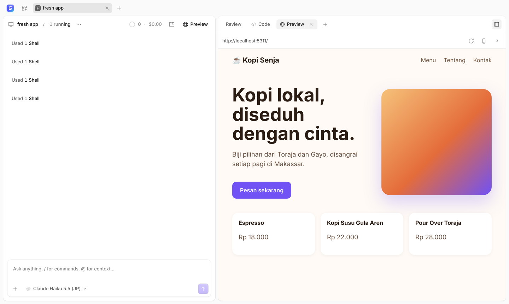
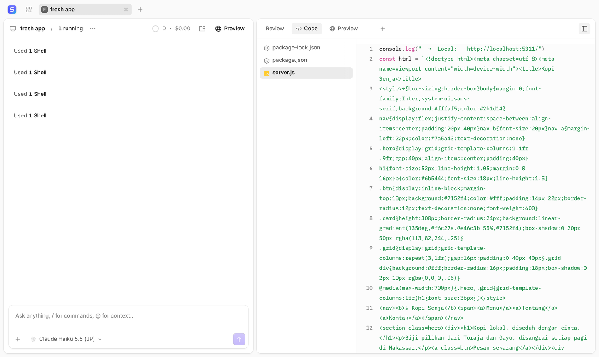
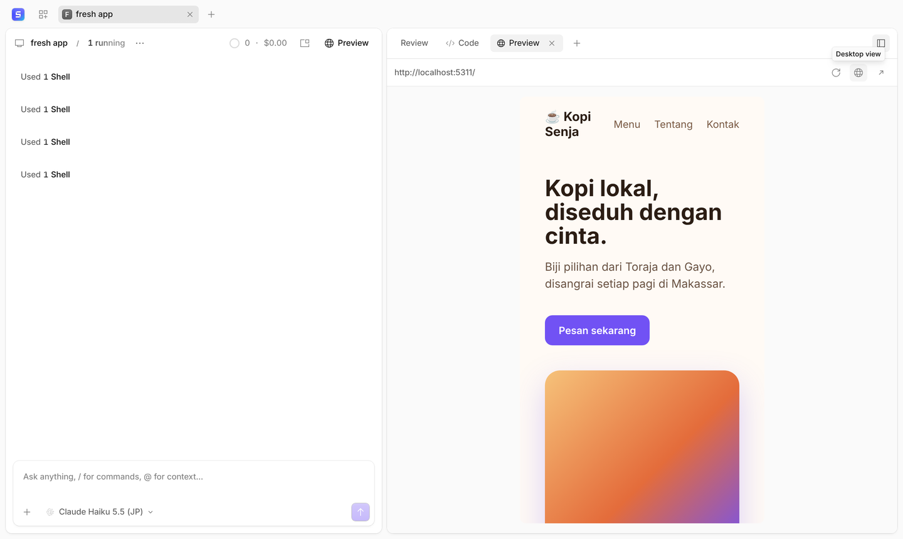

<p align="center">
  <picture>
    <source srcset="docs/assets/supervibecode-wordmark-dark.svg" media="(prefers-color-scheme: dark)">
    <source srcset="docs/assets/supervibecode-wordmark-light.svg" media="(prefers-color-scheme: light)">
    
  </picture>
</p>
<p align="center"><b>Vibe-code real apps with an AI agent, and watch them run beside the chat.</b></p>
<p align="center">
  Built on <a href="https://github.com/anomalyco/opencode">OpenCode</a>, the open source AI coding agent.
</p>

<p align="center">
  
</p>

---

## What is SuperVibeCode?

SuperVibeCode is a desktop and web app for building apps by talking to an AI agent, in the spirit of Lovable, but
running on your own computer, with your own projects, models and git. It is a fork of [OpenCode](https://github.com/anomalyco/opencode)
that keeps everything OpenCode does (any model provider, agents, terminal, file tools, review) and adds an app-builder
workflow on top.

### Features

- **Live preview.** When a dev server starts, the app shows up in the panel on the right. It works for servers the
  agent starts, `!npm run dev` in the composer, and the built-in terminal (`` Ctrl+` ``). Vite, Next.js, Nuxt, Astro,
  Angular, Create React App, Remix, Bun, Laravel (`php artisan serve`), Django, Rails and Flask are recognized, as is
  any server that prints the port it listens on.
- **The agent runs your app.** It installs dependencies and starts the dev server in the background itself, instead of
  asking you to.
- **One-click Start.** Open a session from your history and press **Start** in its header. SuperVibeCode remembers the
  command the session used, or reads it from the project (`package.json` scripts with npm, pnpm, yarn or bun, or
  Laravel's `artisan`) and installs missing dependencies first.
- **Code tab.** The project's files and their code sit next to the preview, with line comments you can send to the
  agent.
- **Mobile view.** Toggle a phone-sized viewport to check the responsive layout.
- **Local links open inside the app.** When the agent says "see it at `http://localhost:5174/about`", the link opens
  in the preview, not in another browser.
- **Automatic git.** Each agent turn that changes files becomes a commit named after your prompt. Commits push to
  your branch with the git login already on your computer, and GitHub Desktop sees them at once. Environment files and
  private keys are never committed.
- **Start from a template.** **New from template** on the home screen creates a React + Vite, Next.js, Vue, HTML or
  Laravel project with Tailwind CSS and opens a session ready for you to say what to build.
- **History and restore.** The **History** tab lists every version the agent made. Restoring one adds a new commit, so
  it reaches GitHub like any other change and nothing is lost.
- **Fix with AI.** When the page in the preview shows an error, one click sends it to the agent.
- **Deploy to Vercel.** **Deploy** in the session header has the agent publish the app with the Vercel CLI, signing in
  the first time.
- **Supabase built in.** Turn on `supabase` with **Toggle MCPs** (`Ctrl+;` or `Cmd+;`) and sign in, and the agent can
  create the database tables, auth and storage your app needs.
- **Design skills built in.** The agent designs with [Taste Skill](https://github.com/Leonxlnx/taste-skill) instead of
  the generic look AI-made pages tend to have, and four more design skill sets are one `@` away. See
  [Design skills](#design-skills).
- **Cross-platform.** macOS, Windows and Linux.

<p align="center">
  
  
</p>

## Getting started

### Install

Download the installer for your computer from the [latest release](https://github.com/dhank77/SuperVibeCode/releases/latest):
the `.dmg` for macOS (`arm64` for Apple silicon, `x64` for Intel), the `.exe` for Windows, or the `.AppImage`, `.deb` or
`.rpm` for Linux. On Windows and Linux the app updates itself from new releases; on macOS, download new
releases yourself until the app is signed.

The installers are not signed yet, so the first launch needs one extra step:

- **macOS:** open the app once from Finder with right-click → **Open**, then **Open** again. If macOS says the app is
  damaged, run `xattr -dr com.apple.quarantine /Applications/SuperVibeCode.app` in Terminal.
- **Windows:** in the SmartScreen prompt, choose **More info** → **Run anyway**.

### Run from source

**Requirements:** [Bun](https://bun.sh) 1.4.4 or newer and [git](https://git-scm.com). Node.js is not required.

```bash
git clone https://github.com/dhank77/SuperVibeCode.git
cd SuperVibeCode
bun install

# the desktop app
bun run dev:desktop
```

Prefer the browser? Run the server and the web app in two terminals:

```bash
bun dev serve --port 4096                 # from the repository root
cd packages/app && bun dev -- --port 4444  # then open http://localhost:4444
```

Connect a model provider under **Settings → Providers**, open a folder as a project, and ask for an app. For example:

> Create a React app with Vite in this folder, run it, and make the home page a landing page for a coffee shop.

### Automatic push

Commits push only when git on your computer can push without asking for a password. Sign git in once:

```bash
gh auth login && gh auth setup-git
```

On Windows, Git Credential Manager asks once on the first push instead. Until then, commits stay on your computer and
you can push them from GitHub Desktop. Turn automatic commits or pushes off from the command palette (`Cmd/Ctrl+K`).

## Design skills

SuperVibeCode ships these skills, ready without installing anything. Only Taste Skill runs on its own; the others run
when you attach them by typing `@` and the skill's name in the message, so their rules never compete.

| Skill                                                   | Runs                                                             | Use it to                                                                                               |
| ------------------------------------------------------- | ---------------------------------------------------------------- | ------------------------------------------------------------------------------------------------------- |
| `@taste-skill`                                          | Automatically when the agent builds or restyles a page or screen | Pick an art direction and avoid template-looking design                                                 |
| `@impeccable`                                           | When you attach it                                               | Critique, audit, polish, or push a design bolder or quieter (`@impeccable audit`, `@impeccable polish`) |
| `@frontend-design`                                      | When you attach it                                               | Anthropic's guidance for distinctive frontend design                                                    |
| `@ui-ux-pro-max`                                        | When you attach it                                               | Search palettes, font pairings, UI styles and UX rules (needs Python 3)                                 |
| `@emil-design-eng`, `@emil-animate` and other `@emil-*` | When you attach them                                             | Animation and interaction polish, mobile feel, stress-testing UI                                        |

A skill of the same name in your own skills folder replaces the bundled one. To turn the bundled skills off, set
`SUPERVIBECODE_BUILTIN_SKILLS=0`. Running from source, they load from the `skills/` folder; a compiled build downloads
them once from this repository. Each skill keeps its original license; see [skills/NOTICE.txt](skills/NOTICE.txt).

## Releasing

Push a version tag and GitHub Actions builds the installers for macOS, Windows and Linux and publishes them as a release:

```bash
git tag v1.0.0
git push origin v1.0.0
```

You can also run the **supervibecode-release** workflow from the repository's Actions tab with a version number. To sign
and notarize the macOS app, add the secrets listed at the top of
[`.github/workflows/supervibecode-release.yml`](.github/workflows/supervibecode-release.yml).

## Staying up to date with OpenCode

SuperVibeCode follows OpenCode's `dev` branch. Its own changes live mostly in new folders
(`packages/gui-extensions/src/preview`, `packages/gui-extensions/src/autogit`), so merges stay small:

```bash
git remote add upstream https://github.com/anomalyco/opencode.git   # once
git fetch upstream
git merge upstream/dev
bun install
```

## Credits and license

SuperVibeCode is based on **[OpenCode](https://github.com/anomalyco/opencode)** by Anomaly Innovations, Inc. and its
contributors. Nearly all of the agent, server, desktop app and terminal UI is their work. Thank you.

The bundled design skills are the work of their authors: [Taste Skill](https://github.com/Leonxlnx/taste-skill) by
Leon Lin (MIT), [Impeccable](https://github.com/pbakaus/impeccable) by Paul Bakaus (Apache-2.0),
[frontend-design](https://github.com/anthropics/skills) by Anthropic (Apache-2.0),
[UI UX Pro Max](https://github.com/nextlevelbuilder/ui-ux-pro-max-skill) by Next Level Builder (MIT) and
[Emil Kowalski's skills](https://github.com/emilkowalski/skills) (MIT).

SuperVibeCode is an independent project. It is **not built by the OpenCode team and is not affiliated with or endorsed
by them**. OpenCode is a registered trademark of Anomaly Innovations, Inc.

Like OpenCode, SuperVibeCode is released under the [MIT License](LICENSE). The original copyright notice is kept in
`LICENSE`, as the license requires.

For OpenCode's own documentation, see [opencode.ai/docs](https://opencode.ai/docs). Most of it applies here too.
